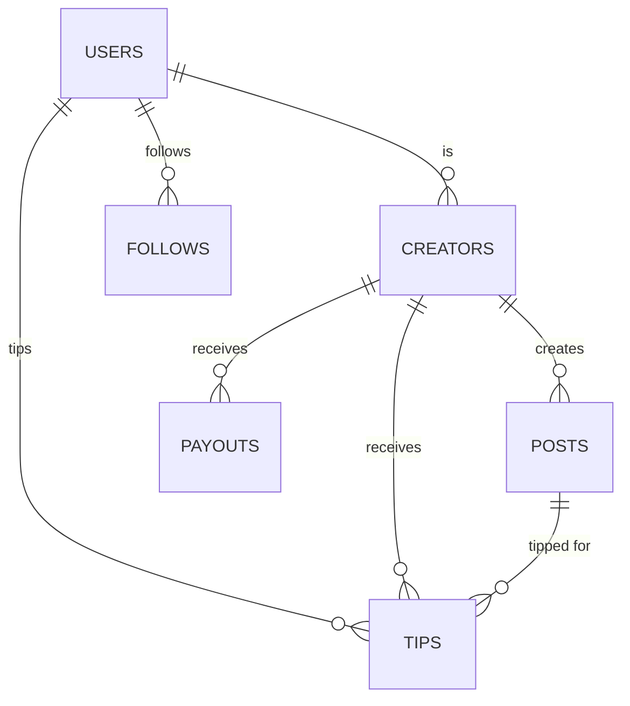

# Data Model Overview

This document describes the relational schema used by the content‑feed service and provides a visual ER diagram.

## Mermaid Diagram

## Table Descriptions

- **users** – Core account information. Primary key `id`.
- **creators** – Sub‑set of users that can publish content. One‑to‑one with `users` via `user_id`.
- **posts** – Content created by a creator. References `creators(user_id)`.
- **follows** – Many‑to‑many relationship where a user follows a creator. Composite primary key `(follower_id, creator_id)`.
- **tips** – Monetary tip from a user (`tipper_id`) to a creator for a specific post. Stores amounts in minor units:
  - `gross_amount` – total tip value.
  - `platform_fee` – portion taken by the platform.
  - `creator_amount` – amount credited to the creator.
  - A check constraint guarantees `gross_amount = platform_fee + creator_amount`.
- **payouts** – Records of payouts from the platform to creators for a given period.

## Indexes
- `idx_posts_created_at` – Optimises feed queries ordering by newest posts.
- `idx_follows_creator_id` – Speeds lookup of followers for a creator.
- `idx_tips_creator_id` – Enables fast aggregation of a creator's balance.
